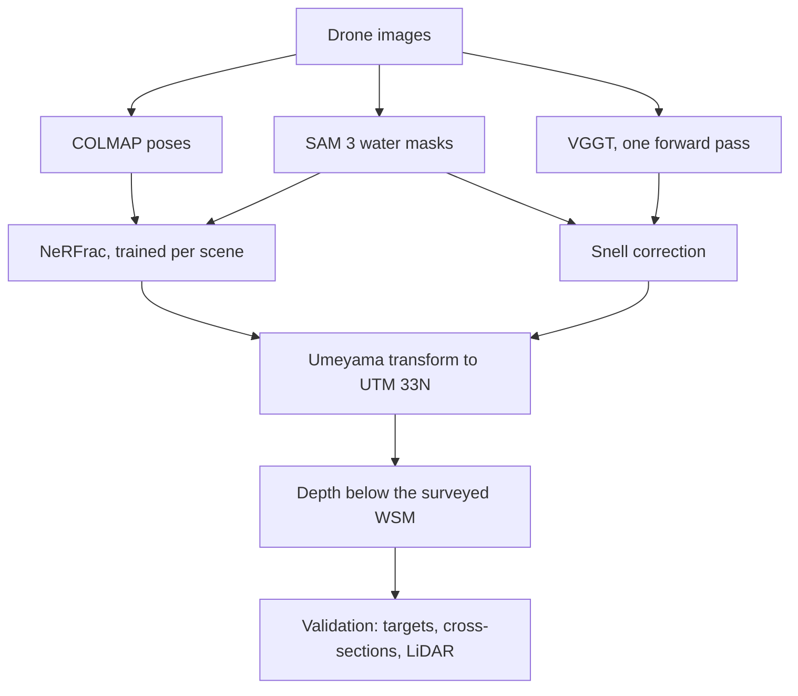

# NeuroBathy

Shallow-water bathymetry from drone images with two neural 3D reconstruction methods,
corrected for refraction and validated against surveyed ground truth. This is the code
for my MSc thesis in Computer Science at TU Berlin (Remote Sensing Image Analysis Group,
2026).

Light bends where it enters the water, so a riverbed seen from the air looks shallower
than it is. I compare two ways to recover the true depth from RGB drone images:

- NeRFrac (Zhan et al., ICCV 2023), a NeRF that is trained per scene, learns the water
  surface and refracts every ray through it with Snell's law. I adapted it to drone
  imagery.
- VGGT (Wang et al., CVPR 2025), a pretrained model that predicts depth and camera poses
  in one forward pass. It does not model refraction, so I correct its depths with
  Snell's law afterwards.

I also wrote the water masking with SAM 3, the georeferencing to UTM coordinates and the
validation against the surveyed ground truth of the Pielach River in Austria. On 138
surveyed points up to 1.2 m deep, the best NeRFrac model has an RMSE of 0.34 m.

## Results

Pielach River, October 2024, flown at 80 m. Nadir images look straight down. The oblique
set has 6 images tilted by 45-50° and 3 near-nadir images. The 280 images mix 100 nadir
and 180 oblique views.

Depth is measured below the surveyed water surface model (WSM). The table discards
predictions deeper than 5 m or above the WSM. The Targets column uses the 8 underwater
reference targets (0.67-1.19 m deep). The All columns add 130 cross-section points,
138 points in total. VGGT has predictions at 116 of them and
the oblique model without distortion loss at 136. The LiDAR columns compare the
underwater cells with the bathymetric LiDAR point cloud of the dataset on a 0.1 m grid.
RMSE is in metres and |ρ| is the absolute Spearman rank correlation between predicted
and surveyed depth. No scale correction is applied. The table is a selection of the models I
evaluated. The nadir NeRFrac models are left out: their learned surface sits 7-9 m too
low, and without a scale correction their RMSE is 2.9 m or more.

| Method | Images | Setup | Targets RMSE | All RMSE | All \|ρ\| | LiDAR RMSE | LiDAR \|ρ\| |
|---|---|---|---:|---:|---:|---:|---:|
| NeRFrac | 9 oblique | distortion loss, 256 samples | 0.54 | 0.34 | 0.48 | 0.49 | 0.39 |
| NeRFrac | 9 oblique | distortion loss, 64 samples | 0.51 | 0.46 | 0.27 | 0.49 | 0.21 |
| NeRFrac | 9 oblique | 64 samples | 0.44 | 0.88 | 0.10 | 0.64 | 0.24 |
| NeRFrac | 280 nadir and oblique | distortion loss, 256 samples | 0.40 | 0.58 | 0.34 | 0.49 | 0.41 |
| NeRFrac | 280 nadir and oblique | 256 samples | 0.45 | 1.09 | 0.35 | 1.05 | 0.44 |
| VGGT | 9 nadir | no Snell correction | 0.27 | 0.59 | 0.16 | 0.56 | 0.08 |
| VGGT | 9 nadir | multi-view Snell correction | 0.35 | 0.51 | 0.15 | 0.52 | 0.15 |

No model wins every column. NeRFrac on the 9 oblique images with distortion loss and
256 samples has the lowest RMSE on all points (0.34 m), most of which are shallow: only
14 of the 130 cross-section points are deeper than the shallowest target. VGGT without
Snell correction has the lowest RMSE on the 8 targets (0.27 m). Each method is shown on the images
where it works. NeRFrac needs oblique views, and VGGT's cameras fail
on them.

All NeRFrac models in the table are trained at 1024 × 683 px for 950k iterations with
the water masks, the cross-view depth consistency loss and the smoothness term.
"256 samples" means 256 coarse and 256 fine samples per ray with 4096 rays per batch.
"64 samples" means 64 + 64 with 512 rays. The depth is taken at the sample with the
highest weight on each ray (mode depth). Training took 9-76 h per model on one A100
(80 GB). VGGT needs no training and runs on the 9 images at 518 × 350 px in under 14 s.
For VGGT the height also comes from the WSM. `02_extract_bathymetry.py` shifts the VGGT
points vertically by the median offset between the highest 10% of its water points and
the WSM.

The georeferencing has its own error. Fitting the camera centres to the GPS positions
leaves an XY residual of 0.17 m for NeRFrac on the oblique images, 0.10 m on the 280
images and 0.69 m for VGGT, see [`data/transforms`](data/transforms).

## Findings

- The water surface NeRFrac learns behaves like a nuisance parameter. An underwater
  point is the surface point plus a depth along the refracted ray. For near-vertical
  rays, a surface that is too low and a depth that is too short give almost the same
  point and the same image, so the photometric loss hardly constrains the surface.
  Oblique views constrain it more, but not fully. The model with the lowest all-point
  RMSE has the worst learned surface of the models in the table (RMSE 3.11 m against
  the WSM). Measured below a plane fitted to its own surface, its RMSE is 2.72 m instead
  of 0.34 m. That is why the table uses the surveyed WSM.
- NeRFrac and VGGT fail in opposite ways. Over the whole river, NeRFrac ranks depths
  better (LiDAR |ρ| up to 0.44, VGGT 0.08 and 0.15). It overpredicts depth by a factor
  of 1.2 for the best oblique model and by up to 34 for the nadir models. VGGT has the
  best RMSE on the 8 targets (0.27 m, bias +0.10 m) but ranks depths poorly. On the 20
  points deeper than 0.7 m this flips: the ranking of the best NeRFrac model inverts
  (ρ = -0.57) and VGGT's improves (ρ = +0.54).
- Distortion loss lowers the RMSE on all points from 0.88 to 0.46 m on the 9 oblique
  images and from 1.09 to 0.58 m on the 280 images. On the oblique targets it does not
  help (0.44 to 0.51 m).
- The mode depth lowers the RMSE by 6-66% compared to the expected depth, for the five
  NeRFrac models trained without distortion loss. The models with distortion loss were
  only evaluated with the mode.

## What I changed in NeRFrac

- Per-ray water/land routing: water rays are refracted at the learned surface, land
  rays are rendered along straight lines, and both use the same coarse and fine
  radiance MLPs.
- Losses: distortion loss (Mip-NeRF 360), cross-view depth consistency, an optional
  flatness term, and the smoothness term that upstream defines but never calls.
- Outputs: expected depth, mode depth and accumulated opacity for every rendered view.
  Upstream saved only the RGB image and the surface points.
- Georeferencing: the camera transform and LLFF scale are saved with each experiment,
  so renders can be mapped back to COLMAP and UTM coordinates.
- Training safeguards: gradient clipping, skipping batches with a NaN or Inf loss, and
  clamping the refractive offset and the term under the square root in Snell's law.

The full list is in [`models/nerfrac_modified/README.md`](models/nerfrac_modified/README.md).

## Pipeline



| Step | Script |
|---|---|
| Camera poses | COLMAP and LLFF's `imgs2poses.py`, installed separately |
| Water masks from text prompts | [`sam3_mask_generator/generate_water_masks.py`](sam3_mask_generator/generate_water_masks.py) |
| NeRFrac training and rendering | [`models/nerfrac_modified/run_nerfrac.py`](models/nerfrac_modified/run_nerfrac.py) |
| VGGT depth and cameras | [`models/vggt/run_vggt_inference.py`](models/vggt/run_vggt_inference.py) |
| Similarity transform to UTM 33N, from camera centres and EXIF GPS | [`postprocessing/01_compute_umeyama.py`](postprocessing/01_compute_umeyama.py) |
| Snell correction of the VGGT depths | [`postprocessing/04_correct_refraction.py`](postprocessing/04_correct_refraction.py) |
| Depth below the WSM or below a plane fitted to the learned surface | [`postprocessing/02_extract_bathymetry.py`](postprocessing/02_extract_bathymetry.py) |
| Validation against targets and cross-sections | [`postprocessing/03_validate.py`](postprocessing/03_validate.py) |
| Scene point clouds | [`postprocessing/07_make_pointcloud.py`](postprocessing/07_make_pointcloud.py) |
| Learned water surface against the WSM | [`postprocessing/08_water_surface_analysis.py`](postprocessing/08_water_surface_analysis.py) |
| Errors per depth range | [`postprocessing/10_depth_stratified.py`](postprocessing/10_depth_stratified.py) |
| Scale and affine correction | [`postprocessing/11_scale_correction.py`](postprocessing/11_scale_correction.py) |
| Land control points | [`postprocessing/14_control_point_validation.py`](postprocessing/14_control_point_validation.py) |
| Comparison with the bathymetric LiDAR | [`postprocessing/15_lidar_comparison.py`](postprocessing/15_lidar_comparison.py) |

The scripts in `postprocessing/`, `models/vggt/` and `sam3_mask_generator/` have usage
examples at the top. The numbers are kept from my thesis code, so some are missing. For
VGGT the order is `run_vggt_inference.py`, 01 (`--mode vggt`), 04, 02 (`--mode vggt` on
the output folder of 04) and 03.

## Setup

VGGT and SAM 3 pin different PyTorch versions, so there are three conda environments:

```bash
conda env create -f environment.yml                      # neurobathy: NeRFrac and postprocessing
conda env create -f models/vggt/environment.yml          # neurobathy-vggt
conda env create -f sam3_mask_generator/environment.yml  # neurobathy-sam3
```

The versions are the ones behind the thesis results, with PyTorch wheels for CUDA 12.
The SAM 3 checkpoint is gated: request access on Hugging Face, then run `hf auth login`
in `neurobathy-sam3`. VGGT downloads the VGGT-1B weights (about 5 GB) on the first run.
They are licensed [CC BY-NC 4.0](https://creativecommons.org/licenses/by-nc/4.0/)
(non-commercial). COLMAP, LLFF and ImageMagick (`load_llff.py` downsizes the images with
`mogrify`) are installed separately.

## Data

- [`data/gt/pielach/`](data/gt/pielach): water surface model, control points,
  underwater targets and cross-section points, unmodified from the
  [Pielach River dataset](https://doi.org/10.48436/taz19-r6618). The drone images
  (folder 09) and the bathymetric LiDAR point cloud (folder 03) have to be downloaded
  from there.
- [`data/transforms/`](data/transforms): the georeferencing transforms of the thesis
  reconstructions. A new COLMAP run has its own coordinate frame and needs its own
  transform from `01_compute_umeyama.py`.

## Running NeRFrac on Pielach

Download the drone images (folder 09, a 23.8 GiB archive) from the
[dataset](https://doi.org/10.48436/taz19-r6618). The example uses the 9 nadir images of
the along-river flight (`20241025_Pielach-1-along`). [LLFF](https://github.com/Fyusion/LLFF)'s
`imgs2poses.py` runs COLMAP and writes `sparse/0/` and `poses_bounds.npy` into the scene
folder. The masks are generated from the downsized images, so create those first.
Without masks, or with a different number of masks than images, NeRFrac treats every
pixel as water and only prints a warning.

```bash
conda activate neurobathy
mkdir -p data/model_formatted/nerfrac/pielach_data/images
for n in 095404_0195 095418_0210 095429_0222 095613_0312 095626_0326 \
         095640_0341 095900_0470 095914_0485 095924_0496; do
    cp /path/to/20241025_Pielach-1-along/DJI_20241025${n}.JPG \
        data/model_formatted/nerfrac/pielach_data/images/
done
python /path/to/LLFF/imgs2poses.py data/model_formatted/nerfrac/pielach_data

mkdir data/model_formatted/nerfrac/pielach_data/images_4
mogrify -path data/model_formatted/nerfrac/pielach_data/images_4 -resize 25% -format png \
    data/model_formatted/nerfrac/pielach_data/images/*.JPG

conda activate neurobathy-sam3
python sam3_mask_generator/generate_water_masks.py \
    --input_dir data/model_formatted/nerfrac/pielach_data/images_4 \
    --output_dir data/model_formatted/nerfrac/pielach_data/masks_4 \
    --scene river
```

Train and render all views. The config paths are relative to `models/nerfrac_modified/`.
[`configs/pielach.txt`](models/nerfrac_modified/configs/pielach.txt) is an example
configuration (2048 × 1365 px, 200k iterations), not one of the models in the table.

```bash
conda activate neurobathy
cd models/nerfrac_modified
python run_nerfrac.py --config configs/pielach.txt
python run_nerfrac.py --config configs/pielach.txt --render_only --render_all
```

The experiment name is built from the config values, so the renders (RGB, mean and mode
depth, opacity and water surface points per view) go into
`logs/pielach_nerfrac_d-0.4_yita1.333_tframe4_factor4multires2_4_64/renderonly_all_200000/`,
named after the render mode and the checkpoint. Georeference the renders, extract the
depth below the WSM and validate:

```bash
cd ../../postprocessing
scene=../data/model_formatted/nerfrac/pielach_data
log=../models/nerfrac_modified/logs/pielach_nerfrac_d-0.4_yita1.333_tframe4_factor4multires2_4_64
gt=../data/gt/pielach

python 01_compute_umeyama.py --mode nerfrac \
    --colmap_sparse_dir $scene/sparse/0 \
    --image_dir $scene/images \
    --output transforms/pielach_umeyama.npz

python 02_extract_bathymetry.py --mode nerfrac \
    --testset_dir $log/renderonly_all_200000 \
    --log_folder $log \
    --data_dir $scene \
    --umeyama_npz transforms/pielach_umeyama.npz \
    --mask_dir $scene/masks_4 \
    --wsm_path $gt/05_water_surface_model/Pielach_20241024_WSM.tif \
    --depth_type mode \
    --output_csv bathymetry/pielach.csv

python 03_validate.py \
    --pred_csv bathymetry/pielach.csv \
    --ref_csv $gt/07_underwater_reference_targets/Pielach_20241024_underwater_reference_targets.csv \
    --transect_csv $gt/08_underwater_transect_points/Pielach_20241024_underwater_transect_points.csv \
    --wsm_path $gt/05_water_surface_model/Pielach_20241024_WSM.tif \
    --label "NeRFrac Pielach" \
    --output_dir validation/pielach
```

`03_validate.py` writes the matched points to `validation/pielach/comparison.csv`.
Scripts 10 and 11 take it as input. Script 14 also needs the point cloud from 07 and the
control points.

## Limitations

- The results need a surveyed water surface model (see Findings).
- NeRFrac has no metric depth supervision. The nadir models overpredict depth by a
  factor of up to 34 and need a scale correction fitted on ground truth. With oblique
  views the factor is 1.2 to 3.0.
- VGGT's camera estimates break down on the oblique and 280-image sets (XY residuals of
  13-16 m after georeferencing), so the table only shows VGGT on the 9 nadir images.
- All numbers come from one river with dense ground truth.

Not included yet: the configurations and image lists of the models in the table, tests,
and one script that runs the whole postprocessing. The trained checkpoints are not
public yet.

## Credits

- [NeRFrac](https://github.com/Yifever20002/NeRFrac) by Yifan Zhan, Shohei Nobuhara,
  Ko Nishino and Yinqiang Zheng (ICCV 2023). It builds on [NeRF](https://github.com/bmild/nerf)
  and [nerf-pytorch](https://github.com/yenchenlin/nerf-pytorch). `models/nerfrac_modified/`
  is a modified copy. Its README has the BibTeX.
- [VGGT](https://github.com/facebookresearch/vggt) (Wang et al., CVPR 2025, University of
  Oxford and Meta AI) and [SAM 3](https://github.com/facebookresearch/sam3) (Carion et al.,
  2025, Meta) are installed separately and come with their own licenses.
- [Pielach River research dataset October 2024](https://doi.org/10.48436/taz19-r6618) by
  G. Mandlburger, TU Wien, licensed [CC BY 4.0](https://creativecommons.org/licenses/by/4.0/).
  It is described in [Mandlburger et al. (2025)](https://doi.org/10.23784/HN130-06).
- The thesis was supervised by Prof. Dr. Begüm Demir and advised by
  Dr.-Ing. Panagiotis Agrafiotis.

## License

The code is MIT licensed, see [`LICENSE`](LICENSE). Third-party code keeps its own
license, see [`THIRD_PARTY_NOTICES.md`](THIRD_PARTY_NOTICES.md).

The MIT license does not cover `data/`. The files there are
[CC BY 4.0](https://creativecommons.org/licenses/by/4.0/). The ground truth in
`data/gt/pielach/` is copied unmodified from the Pielach River dataset. I computed the
transforms in `data/transforms/` from the same dataset. The `vggt_*` transforms come
from VGGT-1B camera estimates, and the VGGT-1B weights are CC BY-NC 4.0. The READMEs in
both folders have the attribution.
