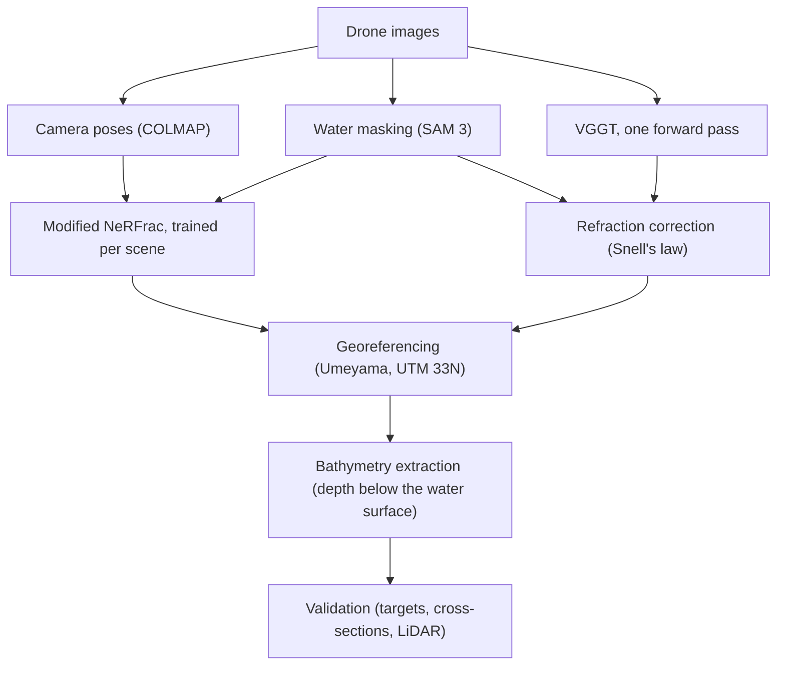
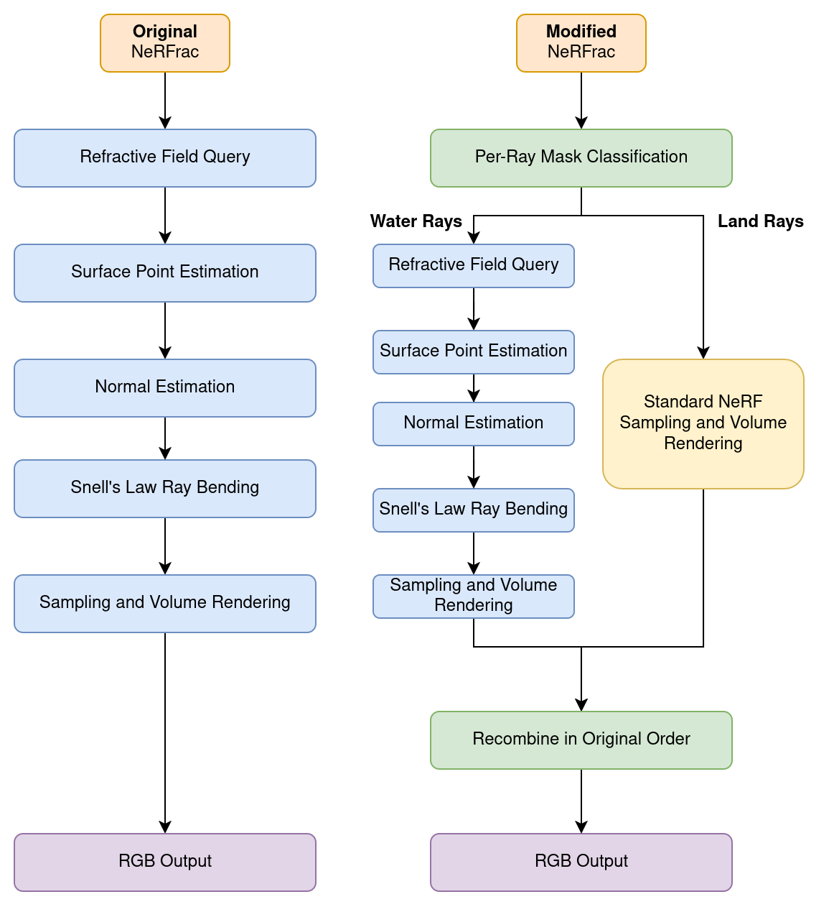

# NeuroBathy

Shallow-water bathymetry from drone images with two neural 3D reconstruction methods,
corrected for refraction, georeferenced and validated against surveyed ground truth.

This is the code of my MSc thesis *Physics-Informed Neural 3D Scene Reconstruction in
Ocean Remote Sensing* (Computer Science, TU Berlin, Remote Sensing Image Analysis Group,
2026).

Light bends where it enters the water, so a riverbed seen from the air looks about 25%
shallower than it is. I built an end-to-end pipeline that recovers the true depth from
RGB drone images with two methods:

- NeRFrac (Zhan et al., ICCV 2023), a neural radiance field trained per scene that
  learns the water surface and refracts every ray through it with Snell's law. I
  extended it from a fixed 3 × 3 camera array above an aquarium to drone imagery, with
  up to 280 images per scene.
- VGGT (Wang et al., CVPR 2025), a pretrained transformer that predicts depth and camera
  poses in one forward pass. It does not model refraction, so I correct its depths with
  Snell's law afterwards.

On the Pielach River in Austria, the best NeRFrac model reaches an RMSE of 0.34 m on 138
survey points up to 1.2 m deep, measured below the surveyed water surface. VGGT reaches
0.27 m on the 8 underwater reference targets.



## What I built

- SAM 3 segments the water from text prompts. My script merges everything the prompts
  find, falls back to other prompts when they find nothing, and can recover missed water
  by its colour.
- My version of NeRFrac routes water and land rays separately, adds the distortion and
  cross-view depth consistency losses, and saves every rendered view with its depth. The
  changes are listed [below](#what-i-changed-in-nerfrac).
- I save VGGT's depth, point maps and cameras per view, so the same postprocessing reads
  them, and `04_correct_refraction.py` corrects its water points with Snell's law in
  three variants.
- I built the complete chain from NeRFrac's NDC space through the LLFF and COLMAP frames
  to UTM 33N, with a similarity transform fitted to the GPS positions of the cameras. On
  the three image sets, the COLMAP cameras match the GPS to 0.14-0.24 m (horizontal
  RMS).
- Both methods share one postprocessing: depth below the water surface on a 0.1 m grid,
  validated against 8 underwater targets, 130 cross-section points and a bathymetric
  LiDAR point cloud, plus land control points and an analysis of the learned water
  surface.

Over the project I trained more than 75 NeRFrac models and evaluated 10 VGGT
configurations.

## Results

The Pielach River was flown in October 2024 at 80 m (Mandlburger et al., 2025). I used
three image sets: 9 nadir images looking straight down, 9 oblique images (6 with the
camera pitched 45-50° below the horizon, 3 near-nadir), and all 280 images taken within
50 m of a centre point over the surveyed water surface (100 nadir, 180 oblique).

Depth is measured below the surveyed water surface model (WSM), without scale
correction. Targets are the 8 underwater reference targets (0.67-1.19 m deep). All adds
130 cross-section points, 138 points in total. LiDAR compares the underwater cells with
the bathymetric LiDAR point cloud of the dataset on a 0.1 m grid. RMSE is in metres and
|ρ| is the absolute Spearman rank correlation between predicted and surveyed depth.

| Method | Images | Setup | Targets RMSE | All RMSE | All \|ρ\| | LiDAR RMSE | LiDAR \|ρ\| |
|---|---|---|---:|---:|---:|---:|---:|
| NeRFrac | 9 oblique | distortion loss, 256 samples | 0.54 | **0.34** | **0.48** | **0.48** | 0.39 |
| NeRFrac | 9 oblique | distortion loss, 64 samples | 0.51 | 0.46 | 0.27 | 0.49 | 0.21 |
| NeRFrac | 9 oblique | 64 samples | 0.44 | 0.88 | 0.10 | 0.65 | 0.24 |
| NeRFrac | 280 nadir and oblique | distortion loss, 256 samples | 0.40 | 0.58 | 0.34 | 0.49 | 0.41 |
| NeRFrac | 280 nadir and oblique | 256 samples | 0.45 | 1.09 | 0.35 | 1.04 | **0.44** |
| VGGT | 9 nadir | no Snell correction | **0.27** | 0.59 | 0.16 | 0.57 | 0.08 |
| VGGT | 9 nadir | single-view Snell correction | 0.29 | 0.59 | 0.22 | 0.58 | 0.11 |

NeRFrac on the 9 oblique images with distortion loss and 256 samples has the lowest
error on all points (0.34 m) and against the LiDAR (0.48 m). VGGT without Snell
correction has the lowest error on the 8 targets (0.27 m). The single-view Snell
correction improves how VGGT orders the depths: |ρ| rises from 0.16 to 0.22 on all
points and from 0.08 to 0.11 against the LiDAR.

All NeRFrac models in the table are trained at 1024 × 683 px for 950k iterations with
the water masks, the cross-view depth consistency loss and the smoothness term. "256
samples" means 256 coarse and 256 fine samples per ray with 4096 rays per batch, "64
samples" means 64 + 64 with 512 rays. The depth is taken at the sample with the highest
weight on each ray (mode depth). Training took 9-76 h per model on one A100 (80 GB).
Predictions deeper than 5 m or above the WSM are discarded, which leaves the oblique
model without distortion loss with predictions at 136 of the 138 points.

VGGT runs on the 9 images at 518 × 350 px in under 14 s, and its predictions cover 116
of the 138 points. Its heights are tied to the WSM: `02_extract_bathymetry.py` shifts
its points by the median offset between the highest 10% of its water points and the WSM.

## What I changed in NeRFrac

<p align="center">
  
</p>

- Per-ray water/land routing: water rays are refracted at the learned surface, land
  rays are rendered along straight lines, and both use the same coarse and fine
  radiance MLPs.
- Losses: distortion loss (Mip-NeRF 360), cross-view depth consistency, an optional
  flatness term, and the smoothness term that upstream defines but never calls.
- Outputs: expected depth, mode depth and accumulated opacity for every rendered view.
  Upstream saved only the RGB image and the surface points.
- Georeferencing: the camera transform and LLFF scale are saved with each experiment,
  so renders can be mapped back to COLMAP and UTM coordinates.
- Training safeguards: gradient clipping, skipping batches with a NaN or Inf loss, and
  clamping the refractive offset and the term under the square root in Snell's law.

The full list is in [`models/nerfrac_modified/README.md`](models/nerfrac_modified/README.md).

## Setup

VGGT and SAM 3 pin different PyTorch versions, so there are three conda environments:

```bash
conda env create -f environment.yml                      # neurobathy: NeRFrac, postprocessing
conda env create -f models/vggt/environment.yml          # neurobathy-vggt
conda env create -f sam3_mask_generator/environment.yml  # neurobathy-sam3
```

The versions are the ones behind the thesis results, with PyTorch wheels for CUDA 12.
The SAM 3 checkpoint is gated: request access to `facebook/sam3` on Hugging Face, then
run `hf auth login` in `neurobathy-sam3`. VGGT downloads the VGGT-1B weights (about
5 GB) on the first run. They are licensed
[CC BY-NC 4.0](https://creativecommons.org/licenses/by-nc/4.0/) (non-commercial).
[COLMAP](https://colmap.github.io/), [LLFF](https://github.com/Fyusion/LLFF),
ImageMagick and 7-Zip are installed separately. LLFF's `imgs2poses.py` runs from a plain
clone in the `neurobathy` environment.

## Preparing your own data

You need overlapping drone images with GPS positions in their EXIF. NeRFrac works best
with oblique views (about 45°) from several directions, VGGT with nadir views. In my
runs, 9 oblique images were enough for NeRFrac. Put the images of one scene into
`<scene>/images/` and run the commands below from the repository root (a scene folder
under `data/model_formatted/` is ignored by git). The image with index `tframe` (4 in
the configs) is held out for testing, so a scene needs at least 5 images or a smaller
`tframe`.

1. LLFF's `imgs2poses.py` computes the camera poses with COLMAP (feature extraction with
   one shared camera, exhaustive matching, mapping) and writes `sparse/0/` and
   `poses_bounds.npy`. COLMAP has to be on `PATH`. I used COLMAP 3.6 in LLFF's Docker
   image; COLMAP 3.8 from conda-forge works too. Every image has to register, so remove
   the ones that do not. COLMAP runs are not exactly repeatable: check the near bounds
   of the cameras (second command below). If one is far below the others, a stray point
   close to that camera sets the scale of the whole scene. In both cases delete
   `database.db` and `sparse/` and run it again, because `imgs2poses.py` skips COLMAP
   when `sparse/0/` exists.
2. NeRFrac trains on downscaled images in `images_<factor>/`, made with ImageMagick's
   `mogrify`. Factor 8 turns the 8192 × 5460 px Pielach images into 1024 × 683 px.
   `run_nerfrac.py` creates the folder itself if it is missing.
3. `generate_water_masks.py` writes one PNG per image (255 = water) into
   `masks_<factor>/`. The masks must match `images_<factor>/` in number and size, or
   `run_nerfrac.py` stops. Without a mask folder, every pixel counts as water.
4. `01_compute_umeyama.py` fits a similarity transform from the COLMAP camera centres to
   the EXIF GPS positions, matched by file name. It needs at least 3 cameras and the
   EPSG code of your ground truth's projected CRS (`--target_epsg`, default 25833 for
   UTM 33N). The EXIF heights are used as recorded, so they must be in the height system
   of your ground truth (ellipsoidal for Pielach). Every COLMAP run has its own frame
   and needs its own transform.
5. `02_extract_bathymetry.py` measures the depth below a water surface model GeoTIFF
   (`--depth_method wsm`, the default). Without one, `--depth_method plane_fit` measures
   NeRFrac's depth below a plane fitted to the learned water surface, which is much less
   accurate; VGGT always needs the WSM. `03_validate.py` compares the
   result with surveyed points and uses the WSM to turn their heights into depths.

```bash
conda activate neurobathy
python /path/to/LLFF/imgs2poses.py <scene>
python -c "import numpy as np; print(np.load('<scene>/poses_bounds.npy')[:, 15])"
mkdir <scene>/images_8
mogrify -path <scene>/images_8 -resize 12.5% -format png <scene>/images/*

conda activate neurobathy-sam3
python sam3_mask_generator/generate_water_masks.py \
    --input_dir <scene>/images_8 --output_dir <scene>/masks_8 --scene river

conda activate neurobathy
python postprocessing/01_compute_umeyama.py --mode nerfrac \
    --colmap_sparse_dir <scene>/sparse/0 --image_dir <scene>/images \
    --target_epsg <EPSG> --output postprocessing/transforms/<name>_umeyama.npz
```

To train on the scene, copy `configs/pielach_oblique.txt`, set `expname` and `datadir`
(relative to `models/nerfrac_modified/`) and continue as in the next section.

VGGT needs no COLMAP. `run_vggt_inference.py` takes the full-resolution images, then
`01_compute_umeyama.py --mode vggt` georeferences its cameras,
`04_correct_refraction.py --mode single_view` corrects the water points as in the table,
and `02_extract_bathymetry.py --mode vggt` reads the output folder of 04. VGGT needs
nadir images (see Limitations).

## Reproducing the best model

These steps train the best model of the table on the 9 oblique images, starting in the
repository root. Download folder 09 of the
[Pielach River dataset](https://doi.org/10.48436/taz19-r6618)
(`09_images_nadir_oblique.7z`, 23.8 GiB); the 9 images can be extracted on their own.
The scene uses the poses of my thesis from [`data/poses/`](data/poses), so the shipped
transform fits it.

```bash
conda activate neurobathy
scene=data/model_formatted/nerfrac/pielach_oblique
7z e -o$scene/images /path/to/09_images_nadir_oblique.7z \
    20241025_Pielach-1-along/DJI_20241025095404_0196.JPG \
    20241025_Pielach-1-along/DJI_20241025095418_0210.JPG \
    20241025_Pielach-1-along/DJI_20241025095428_0221.JPG \
    20241025_Pielach-1-along/DJI_20241025095614_0313.JPG \
    20241025_Pielach-1-along/DJI_20241025095626_0326.JPG \
    20241025_Pielach-1-along/DJI_20241025095639_0340.JPG \
    20241025_Pielach-1-along/DJI_20241025095901_0471.JPG \
    20241025_Pielach-1-along/DJI_20241025095914_0485.JPG \
    20241025_Pielach-1-along/DJI_20241025095923_0495.JPG
cp data/poses/pielach_oblique/poses_bounds.npy $scene/
mkdir $scene/images_4
mogrify -path $scene/images_4 -resize 25% -format png $scene/images/*.JPG
```

As in the thesis, the masks are made from the factor-4 images and halved to factor 8.
This gives the thesis masks back pixel for pixel:

```bash
conda activate neurobathy-sam3
python sam3_mask_generator/generate_water_masks.py \
    --input_dir $scene/images_4 --output_dir $scene/masks_4 --scene river
mkdir $scene/masks_8
mogrify -path $scene/masks_8 -resize 50% -format png $scene/masks_4/*.png
```

Train and render all views. The config paths are relative to `models/nerfrac_modified/`.
[`configs/pielach_oblique.txt`](models/nerfrac_modified/configs/pielach_oblique.txt)
holds the settings of the model, rebuilt from its checkpoint and training logs. It
trained for 950k iterations in about 75 h on one A100 (80 GB); with these settings,
training needs about 40 GB of GPU memory. Training samples rays and points at random, so
a new run will not reproduce the table's numbers exactly.

```bash
conda activate neurobathy
cd models/nerfrac_modified
python run_nerfrac.py --config configs/pielach_oblique.txt
python run_nerfrac.py --config configs/pielach_oblique.txt --render_only --render_all
```

The first run creates `images_8/`. The experiment folder
`logs/pielach_oblique_nerfrac_d-0.4_yita1.333_tframe4_factor8multires0_0_256/` gets a
checkpoint every 25k iterations and a test render every 10k, and running the command
again resumes from the last checkpoint. The renders (RGB, mean and mode depth, opacity
and water surface points per view) go into its `renderonly_all_950000/`, named after the
render mode and the checkpoint. Extract the depth below the WSM and validate:

```bash
cd ../../postprocessing
scene=../data/model_formatted/nerfrac/pielach_oblique
logs=../models/nerfrac_modified/logs
log=$logs/pielach_oblique_nerfrac_d-0.4_yita1.333_tframe4_factor8multires0_0_256
gt=../data/gt/pielach

python 02_extract_bathymetry.py --mode nerfrac \
    --testset_dir $log/renderonly_all_950000 \
    --log_folder $log \
    --data_dir $scene \
    --umeyama_npz ../data/transforms/nerfrac_oblique_umeyama.npz \
    --mask_dir $scene/masks_8 \
    --wsm_path $gt/05_water_surface_model/Pielach_20241024_WSM.tif \
    --output_csv bathymetry/pielach_oblique.csv

python 03_validate.py \
    --pred_csv bathymetry/pielach_oblique.csv \
    --ref_csv $gt/07_underwater_reference_targets/Pielach_20241024_underwater_reference_targets.csv \
    --transect_csv $gt/08_underwater_transect_points/Pielach_20241024_underwater_transect_points.csv \
    --wsm_path $gt/05_water_surface_model/Pielach_20241024_WSM.tif \
    --label "NeRFrac oblique" \
    --output_dir validation/pielach_oblique
```

`03_validate.py` prints the RMSE on all points and on the 8 targets, the All and Targets
columns of the table. It also writes every GT point with its nearest grid cell (column
`matched`) to `validation/pielach_oblique/comparison.csv`, the input of scripts 10 and
11; 11 prints the Spearman correlation. `15_lidar_comparison.py` gives the LiDAR columns
from the LiDAR point cloud (folder 03 of the dataset). Script 14 also needs the point
cloud from 07, the control points and the WSM.

## Scripts

| Step | Script |
|---|---|
| Camera poses | COLMAP and LLFF's `imgs2poses.py`, installed separately |
| Water masks from text prompts | [`sam3_mask_generator/generate_water_masks.py`](sam3_mask_generator/generate_water_masks.py) |
| NeRFrac training and rendering | [`models/nerfrac_modified/run_nerfrac.py`](models/nerfrac_modified/run_nerfrac.py) |
| VGGT depth and cameras | [`models/vggt/run_vggt_inference.py`](models/vggt/run_vggt_inference.py) |
| Similarity transform to the CRS of the ground truth, from camera centres and EXIF GPS | [`postprocessing/01_compute_umeyama.py`](postprocessing/01_compute_umeyama.py) |
| Snell correction of the VGGT depths | [`postprocessing/04_correct_refraction.py`](postprocessing/04_correct_refraction.py) |
| Depth below the WSM or below a plane fitted to the learned surface | [`postprocessing/02_extract_bathymetry.py`](postprocessing/02_extract_bathymetry.py) |
| Validation against targets and cross-sections | [`postprocessing/03_validate.py`](postprocessing/03_validate.py) |
| Scene point clouds | [`postprocessing/07_make_pointcloud.py`](postprocessing/07_make_pointcloud.py) |
| Learned water surface against the WSM | [`postprocessing/08_water_surface_analysis.py`](postprocessing/08_water_surface_analysis.py) |
| Errors per depth range | [`postprocessing/10_depth_stratified.py`](postprocessing/10_depth_stratified.py) |
| Scale and affine correction | [`postprocessing/11_scale_correction.py`](postprocessing/11_scale_correction.py) |
| Land control points | [`postprocessing/14_control_point_validation.py`](postprocessing/14_control_point_validation.py) |
| Comparison with the bathymetric LiDAR | [`postprocessing/15_lidar_comparison.py`](postprocessing/15_lidar_comparison.py) |

Every script has usage examples at the top. The script numbers follow my thesis code, so
some numbers are skipped.

## Data

- [`data/gt/pielach/`](data/gt/pielach): water surface model, control points,
  underwater targets and cross-section points, unmodified from the
  [Pielach River dataset](https://doi.org/10.48436/taz19-r6618). The drone images
  (folder 09) and the bathymetric LiDAR point cloud (folder 03) have to be downloaded
  from there.
- [`data/transforms/`](data/transforms): the georeferencing transforms of the thesis
  reconstructions. A new COLMAP run has its own coordinate frame and needs its own
  transform from `01_compute_umeyama.py`.
- [`data/poses/`](data/poses): the camera poses of the oblique set, for the example
  above.

## Limitations

- The results need a surveyed water surface model: the depth is measured below it.
- Without oblique views, NeRFrac recovers the shape of the riverbed but not its scale:
  the nadir models overpredict depth up to 33× and need a scale factor fitted on
  surveyed points (`11_scale_correction.py`).
- VGGT's camera estimates fail on the oblique and 280-image sets (18-22 m horizontal
  residuals after georeferencing), so VGGT is evaluated on the 9 nadir images.
- All numbers come from one river with dense ground truth up to 1.2 m deep.

## Credits

- [NeRFrac](https://github.com/Yifever20002/NeRFrac) by Yifan Zhan, Shohei Nobuhara,
  Ko Nishino and Yinqiang Zheng (ICCV 2023). It builds on [NeRF](https://github.com/bmild/nerf)
  and [nerf-pytorch](https://github.com/yenchenlin/nerf-pytorch). `models/nerfrac_modified/`
  is a modified copy. Its README has the BibTeX.
- [VGGT](https://github.com/facebookresearch/vggt) (Wang et al., CVPR 2025, University of
  Oxford and Meta AI) and [SAM 3](https://github.com/facebookresearch/sam3) (Carion et al.,
  2025, Meta) are installed separately and come with their own licenses.
- [Pielach River research dataset October 2024](https://doi.org/10.48436/taz19-r6618) by
  G. Mandlburger, TU Wien, licensed [CC BY 4.0](https://creativecommons.org/licenses/by/4.0/).
  It is described in [Mandlburger et al. (2025)](https://doi.org/10.23784/HN130-06).
- The thesis was supervised by Prof. Dr. Begüm Demir and advised by
  Dr.-Ing. Panagiotis Agrafiotis.

## License

The code is MIT licensed, see [`LICENSE`](LICENSE). Third-party code keeps its own
license, see [`THIRD_PARTY_NOTICES.md`](THIRD_PARTY_NOTICES.md).

The MIT license does not cover `data/`. The files there are
[CC BY 4.0](https://creativecommons.org/licenses/by/4.0/). The ground truth in
`data/gt/pielach/` is copied unmodified from the Pielach River dataset. I computed the
transforms in `data/transforms/` and the poses in `data/poses/` from the same dataset.
The `vggt_*` transforms come from VGGT-1B camera estimates, and the VGGT-1B weights are
CC BY-NC 4.0. The READMEs in these folders have the attribution.
